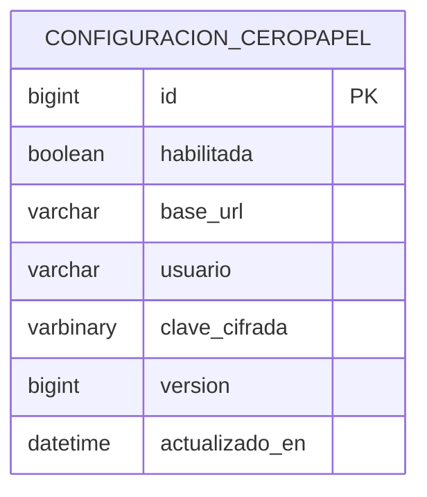

# Configuración operativa de Cero Papel

Diseño validado por el usuario e implementado en la rama de integración.

## Comportamiento

Panel «Integración Cero Papel» dentro de Ingreso de subrogancias. Permite editar URL, usuario y clave, guardar y activar/desactivar globalmente sin reiniciar. Se conserva el usuario actual app_test como valor inicial. El control afecta altas automáticas, altas manuales, consultas y confirmaciones que invoquen al proveedor.

Desactivar bloquea nuevas llamadas; una petición que ya salió podría completarse. Las altas locales continúan, con estado de integración DESACTIVADA y mensaje informativo en el mantenedor. Reactivar afecta nuevas operaciones: no reenvía automáticamente las anteriores. Cambiar URL no reutiliza relaciones de perfiles de otro ambiente ni altera tareas ya aceptadas.

Solo el permiso CONFIGURACION CERO PAPEL permite administrar la configuración. Por instrucción explícita del usuario, no se exige sesión de intranet: el frontend envía rutGestor y el backend comprueba los módulos asignados a ese RUT en la base. Se utiliza el mismo patrón de permisos de los mantenedores existentes. No se consulta un proveedor de autenticación externo.

Las consultas normales no devuelven la clave. El botón de ojito permite revelarla explícitamente a un usuario con el módulo mediante un endpoint separado; no se guarda en localStorage ni en logs. Se cifra con AES-GCM usando una clave maestra de entorno independiente. Clave vacía en una actualización significa conservar la existente. La configuración inicial puede provenir del .env actual; la configuración persistida prevalece. No cambia la versión del framework.

## DER



Una fila global, sin relaciones nuevas. Los módulos y sus permisos reutilizan las tablas existentes.

## DDL MySQL

```sql
CREATE TABLE configuracion_ceropapel (
    id BIGINT NOT NULL,
    habilitada BOOLEAN NOT NULL DEFAULT FALSE,
    base_url VARCHAR(2048) NOT NULL,
    usuario VARCHAR(100) NOT NULL,
    clave_cifrada VARBINARY(4096) NOT NULL,
    version BIGINT NOT NULL DEFAULT 0,
    actualizado_en DATETIME(6) NOT NULL,
    PRIMARY KEY (id),
    CONSTRAINT chk_configuracion_ceropapel_unica CHECK (id = 1)
);
```

3FN: cada atributo depende de la clave de la configuración. La PK basta para las consultas por identificador; no se requieren índices adicionales. Versionado optimista evita sobrescribir ediciones concurrentes.

## Contratos HTTP propuestos

- GET /solicitudes/subrogancia/integracion/estado: devuelve únicamente {habilitada}, sin configuración ni secretos. El mantenedor puede mostrar este estado aunque el usuario no administre la integración.
- GET /solicitudes/subrogancia/integracion/configuracion: permiso CONFIGURACION CERO PAPEL; devuelve {habilitada, url, usuario, claveConfigurada, version}. Nunca devuelve clave ni texto cifrado.
- PUT /solicitudes/subrogancia/integracion/configuracion: mismo permiso por rutGestor y cabecera X-CeroPapel-Config; request record {habilitada, url, usuario, clave, version}. Respuesta igual a GET. Sin paginación, recurso único.

Validaciones: URL absoluta http/https sin usuario, contraseña, query ni fragmento; normalizar barra final. HTTP se conserva por compatibilidad con demo. Solo destinos permitidos por configuración de servidor para impedir llamadas arbitrarias a la red. Usuario obligatorio hasta 100 caracteres. Clave hasta 1900 caracteres; requerida al activar si no existe una previa. Version y habilitada obligatorios. El DTO request oculta la clave en su representación textual.

Estados: 200 guardado; 400 configuración inválida; 400 RUT ausente o inválido; 403 sin permiso; 409 edición concurrente. La operación no prueba credenciales ni envía subrogancias al guardar.

## Verificación prevista

Backend: desactivación sin llamadas externas, alta local conservada, activación con URL/clave nuevos, ausencia de reenvíos, no divulgación de clave, permisos y conflictos de versión. Frontend: visibilidad según permiso, estado desactivado informativo, edición de clave vacía conserva valor y errores de guardado. Compilación y ESLint.

## ADR propuesto

Contexto: la operación requiere suspender el proveedor sin detener el alta local y cambiar credenciales sin reiniciar.
Decisión: configuración persistente global, clave cifrada con secreto de entorno y control obligatorio en backend antes de cada invocación. Permiso específico de administración.
Consecuencias: tabla nueva y clave maestra en despliegue; una llamada en curso no puede deshacerse; la reactivación no provoca reenvíos inciertos. Se valida el módulo del RUT recibido, sin dependencia de sesión de intranet.

## Instalación y operación

1. Reiniciar una vez el backend cargando el .env actualizado. Con ddl-auto=update se crea la tabla nueva; alternativamente aplicar docs/sql/configuracion-ceropapel.sql. El arranque registra el módulo y crea la configuración inicial una sola vez.
2. Asignar CONFIGURACION CERO PAPEL mediante el mantenedor de permisos al administrador. No se conceden privilegios automáticamente a ningún usuario.
3. Acceder con un usuario que tenga el módulo. El RUT del UsuarioContext se envía como rutGestor. No se exige sesión de intranet.
4. El panel muestra el estado global y permite desactivar con un botón directo. «Configurar conexión» permite pegar URL y clave y guardar. Se conserva el usuario inicial app_test y puede editarse.
5. Reactivar utiliza lo guardado. No se reenvían automáticamente las subrogancias locales DESACTIVADA ni se cancelan tareas ya aceptadas.

Variables de despliegue:

- CEROPAPEL_BASE_URL, CEROPAPEL_PASSWORD y CEROPAPEL_USUARIO: semilla inicial. Una vez creada la fila, las ediciones se guardan en la base y prevalecen sobre el entorno.
- CEROPAPEL_HABILITADA: preferencia inicial, solo activa si hay URL y clave iniciales. Sin valores iniciales, el sistema arranca con configuración vacía y desactivada para completarla desde el panel.
- CEROPAPEL_ENCRYPTION_KEY: 32 bytes aleatorios codificados en Base64. Se generó una clave local en .env; conservarla junto a los respaldos de configuración y compartirla entre las instancias del mismo despliegue. Cambiarla requiere recifrar las credenciales guardadas.
- CEROPAPEL_HOSTS_PERMITIDOS: lista de hosts separados por coma; actualmente laflorida.demo.ceropapel.cl. Autorizar el host de producción en esta variable antes de pegar una URL de otro ambiente.

Las ediciones y los cambios de estado quedan registrados sin URL, clave ni credenciales de sesión. Los endpoints de configuración rechazan cambios sin rutGestor válido o sin módulo (400/403), sin la cabecera de escritura (403), con URL no permitida o datos incompletos (400), y con versión desactualizada (409).

La llamada externa toma URL y credenciales al iniciar una operación para no mezclar tokens de ambientes distintos. Antes de cada invocación HTTP se relee el interruptor en una transacción independiente, de modo que una desactivación evita los siguientes pasos de una operación en curso.

## Verificación ejecutada

Pruebas sobre H2 para persistencia de configuración, clave cifrada, versión, URL permitida y contratos HTTP; respuestas que no exponen secretos; autenticación y permisos; pruebas simuladas de altas sin API cuando está desactivada, interrupción entre llamadas y cambio de parámetros sin reiniciar. Frontend validado con compilación y ESLint. No se crean subrogancias reales ni se envían credenciales al proveedor durante las pruebas.

## Ajuste de interfaz: configuración en modal

El mantenedor no muestra la columna Estado ni etiquetas de estado de integración en los resultados. La información técnica sigue disponible en logs y base para diagnóstico. La configuración se abre mediante «Configurar Cero Papel» en la cabecera, visible únicamente al obtener una respuesta autorizada del backend. El modal incluye URL, usuario, clave y «Activar envío» / «Desactivar envío». La activación solo controla nuevas invocaciones de la integración; no cambia el estado local ni cancela programaciones externas existentes. El módulo CONFIGURACION CERO PAPEL ya registrado se asigna desde el mantenedor de permisos; no se conceden permisos automáticamente.

## Revelación explícita de clave

Por solicitud del usuario, el campo permite mostrar/ocultar la clave con un ojito. POST /solicitudes/subrogancia/integracion/clave exige rutGestor con módulo CONFIGURACION CERO PAPEL y cabecera X-CeroPapel-Config: 1; devuelve la clave solo en esa respuesta con Cache-Control: no-store. Los endpoints generales de configuración y valores iniciales siguen sin devolverla. El DTO de revelación oculta la clave en toString; al cerrar el modal se limpia el campo y se restablece el modo oculto.

## Cambio solicitado: acceso sin sesión de intranet

Se eliminó la validación de sesión y la variable CEROPAPEL_AUTH_URL. GET /configuracion, PUT /configuracion y POST /clave reciben rutGestor, validan su formato y consultan el módulo CONFIGURACION CERO PAPEL en la base. Las escrituras y la revelación de clave conservan la cabecera X-CeroPapel-Config. Los controles de envío y el cifrado persistente no cambian.
